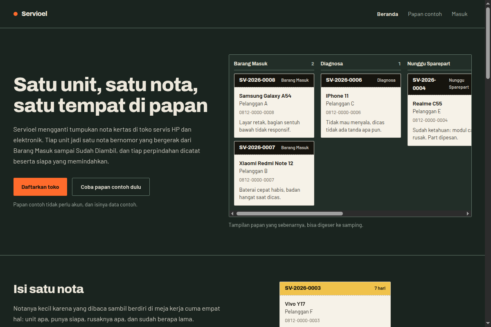

# Servioel

Papan Kanban multi-toko untuk toko servis (HP dan elektronik). Satu sistem dipakai
banyak toko sekaligus, tapi data tiap toko terisolasi: Toko A tidak bisa melihat atau
mengubah nota Toko B.



## Masalah yang diselesaikan

Toko servis kecil biasanya mencatat unit yang masuk di kertas. Kertasnya hilang, tulisan
tangan susah dibaca, dan tidak ada jejak siapa yang memindahkan unit ke tahap berikutnya.
Servioel mengganti tumpukan kertas itu dengan satu papan digital: setiap unit jadi satu
nota bernomor yang berpindah dari **Barang Masuk** sampai **Sudah Diambil**, dan setiap
perpindahan tercatat siapa yang melakukannya.

Satu akun bisa menaungi beberapa toko dalam satu sistem. Karena toko-toko ini berbagi
database yang sama, bagian tersulitnya bukan papan Kanban-nya, melainkan memastikan data
antar toko tidak pernah bocor. Isolasi itulah inti proyek ini, dan diuji otomatis.

## Stack

- **Next.js 16** (App Router) + **React 19** + **TypeScript**
- **Prisma 7** + **PostgreSQL**
- **Tailwind CSS v4**
- **@dnd-kit** untuk drag-and-drop kartu di papan

## Fitur

- **Multi-toko dengan isolasi data.** Setiap baris punya kolom `tokoId`, dan nilainya
  diambil dari sesi login di server, bukan dari apa yang dikirim browser. Setiap query
  disaring dengan `tokoId` itu, sehingga menebak id nota toko lain tidak mengembalikan
  apa pun.
- **Tiga peran:** owner, teknisi, kasir. Pengecekan peran ada di server.
- **Papan Kanban** dengan antrean tahap servis dan drag-and-drop antar kolom.
- **Nomor servis berurutan** per toko per tahun (misal `SV-2026-0007`), dinaikkan di
  dalam transaksi yang sama dengan penyimpanan nota agar tidak ada nomor ganda.
- **Tautan nota publik** untuk pelanggan, pakai token acak (`crypto.randomBytes`),
  bukan id yang bisa ditebak.
- **Sesi aman:** token sesi disimpan sebagai hash, bukan token asli; kata sandi di-hash
  dengan scrypt.
- **Arsip otomatis** unit yang sudah lama di tahap "Sudah Diambil".

## Cara menjalankan

Butuh PostgreSQL yang berjalan di lokal.

```bash
npm install
cp .env.example .env          # isi DATABASE_URL
npm run db:deploy             # terapkan migrasi
npm run db:generate
npm run db:seed               # data contoh (opsional)
npm run dev                   # buka http://localhost:3000
```

## Uji isolasi data

Isolasi antar toko tidak diuji lewat tampilan (tampilan bisa saja cuma menyembunyikan
tombol), melainkan langsung ke fungsi server. Skrip ini membuat dua toko sungguhan,
lalu mencoba membaca dan mengubah nota toko lain, dan memastikan semuanya gagal.

```bash
npm run check:isolasi   # isolasi data antar toko
npm run check:nota      # alur nota
npm run check:pencarian # pencarian di papan
```

## Struktur

- `src/lib/` — logika server: autentikasi, pesanan, toko, tahap servis.
- `src/app/` — halaman (masuk, daftar, papan, nota).
- `prisma/` — skema database dan migrasi.
- `scripts/` — uji otomatis isolasi, nota, dan pencarian.
- `docs/` — PRD, desain, dan catatan keputusan (gate).

## Dokumentasi

- `docs/PRD.md` — kebutuhan produk.
- `docs/DESIGN.md` — keputusan desain dan arsitektur.
- `docs/GATE.md`, `docs/GATE-fase2.md` — catatan keputusan tiap fase.
